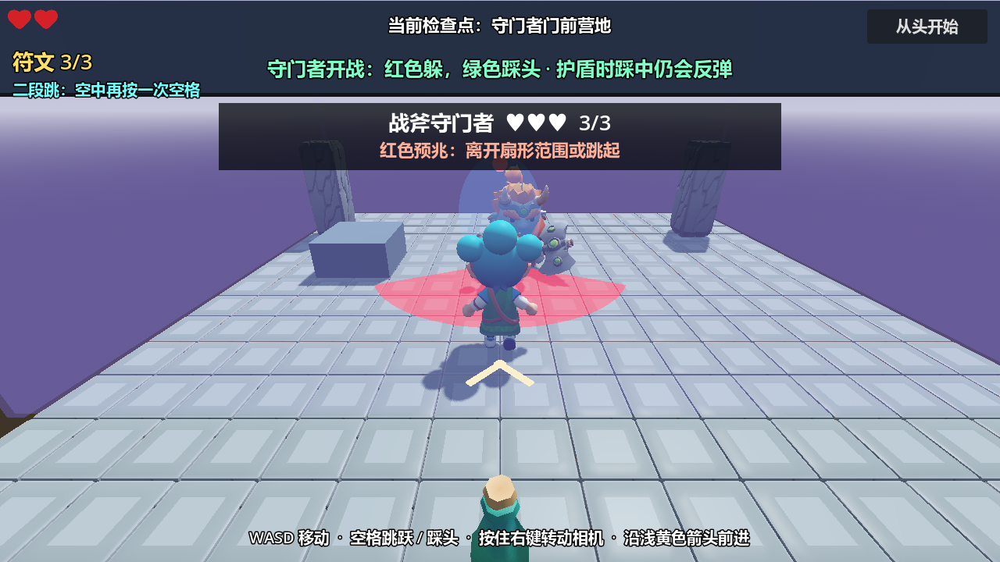

# 3D Platform RPG

Godot 4.6.2 / GDScript 制作的第三人称平台冒险原型。

穿过草地营地、石质遗迹和熔岩庭院，收集三枚符文，解锁二段跳，挑战守门者。



## 运行

使用 Godot 4.6.2 导入 `project.godot`，等待资源导入完成后按 F5。主场景为 `scenes/game.tscn`。

## 操作

| 输入 | 操作 |
| --- | --- |
| WASD | 移动 |
| 空格 | 跳跃；解锁后在空中再次按下可二段跳 |
| 按住鼠标右键并移动 | 转动镜头 |
| 从上方落到敌人头部 | 踩头并反弹 |

普通骷髅和法师可一次踩头击败。守门者只有绿色虚弱期间接受踩头伤害，每轮最多扣一格血；红色预警期间先躲避攻击。

失败后从最近检查点重试，恢复满血，保留符文和二段跳；重新开始会清空本局进度。进度仅保存在内存中。击败守门者后显示用时、死亡次数和符文数量。

## 场景

- `game.tscn`：主流程、HUD、失败菜单和通关结算。
- `level.tscn`：三个区域的地形、装饰和检查点。
- `exploration.tscn`：符文、回血瓶、能力解锁和符文门。
- `mage_encounters.tscn`：法师布置。
- `boss_arena.tscn`：守门者场地、补给和战斗屏障。
- `player.tscn`、`enemy.tscn`、`mage.tscn`、`boss.tscn`：角色场景。
- `test_level.tscn`：独立测试地形。

## 回归检查

```shell
godot --headless --path . --script res://tests/player_test.gd
godot --headless --path . --script res://tests/level_test.gd
godot --headless --path . --script res://tests/progression_test.gd
godot --headless --path . --script res://tests/mage_test.gd
godot --headless --path . --script res://tests/boss_test.gd
godot --headless --path . --script res://tests/environment_test.gd
```

去掉 `--headless` 可进行有画面的检查。测试截图和诊断输出写入 `test_output/`，不进入版本控制。

素材和引擎说明见 [THIRD_PARTY.md](THIRD_PARTY.md)。
